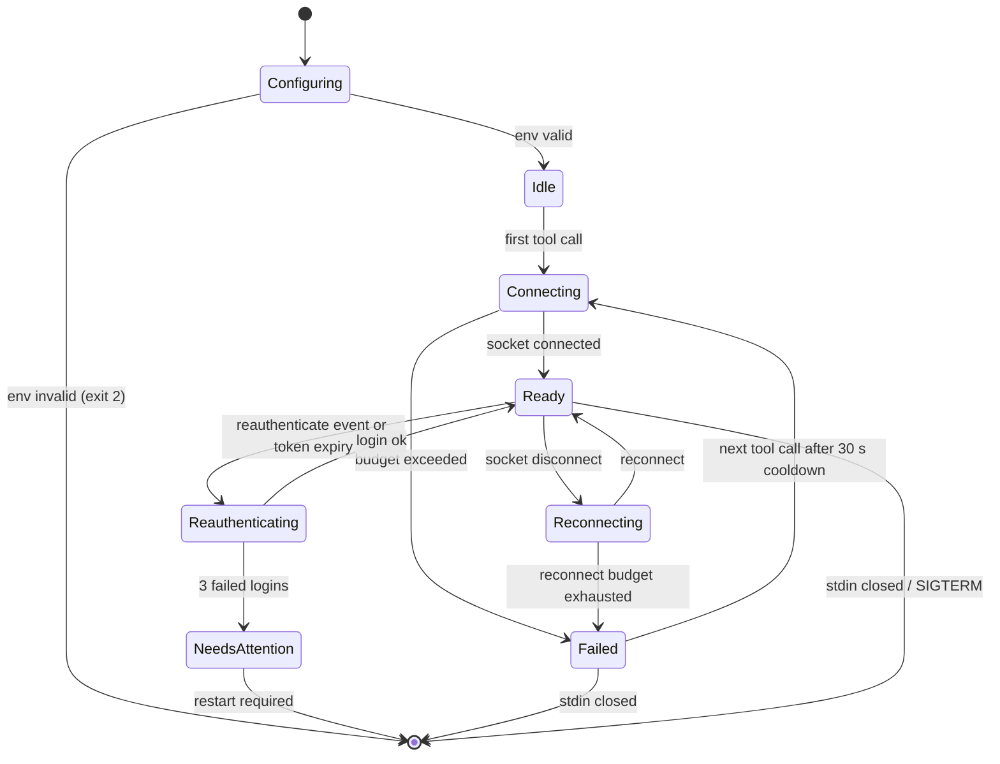

# Standalone MCP server (remote-only) — design

Status: implemented (see `src/mcp` and `test/mcp`)
Scope: a real Model Context Protocol server that talks to ioBroker only, configured
exclusively through environment variables.

Contents: [1 Problem](#1-problem) · [2 Goals](#2-goals-and-non-goals) ·
[3 Why remote-only](#3-why-remote-only) · [4 Threat model](#4-threat-model-and-attack-surface) ·
[5 Tool set](#5-tool-set) · [6 Architecture](#6-architecture) · [7 Configuration](#7-configuration) ·
[8 Secrets and logging](#8-secrets-handling-and-logging) · [9 Auth](#9-authentication-and-re-authentication) ·
[10 Lifecycle](#10-server-lifecycle-and-error-paths) · [11 Interoperability](#11-interoperability) ·
[12 Reused services](#12-services-that-can-be-reused) · [13 Dependency seam](#13-dependency-seam-for-the-core) ·
[14 Build and runtime](#14-build-packaging-and-runtime) · [15 Release and upgrades](#15-release-versioning-and-upgrades) ·
[16 Tests](#16-test-strategy) · [17 Work items](#17-work-items) · [18 Open questions](#18-open-questions) ·
[19 OpenChamber](#19-openchamber-setup-target-state)

## 1. Problem

The extension already exposes 17 language model tools, but they are registered with
`vscode.lm.registerTool` in
[AiToolService.ts](../src/services/aiTool/AiToolService.ts). The command title
`iobroker: Enable/disable MCP server (AI tools)` and the README section "MCP server"
suggest a protocol server that does not exist: MCP is never spoken, so clients such as
OpenChamber, Claude Desktop or Cursor cannot connect.

Everything below the tool layer is already protocol agnostic: `src/aiTools/core` is free
of VS Code imports and receives its dependencies as an explicit
[`ToolDeps`](../src/aiTools/core/types.ts) parameter. That seam is what this design uses.

## 2. Goals and non-goals

Goals:

- A stdio MCP server that any MCP client can start with `npx`.
- **Remote-only**: the server talks to the ioBroker socket and needs no local workspace,
  no local script files and no filesystem access at all.
- Configuration entirely through environment variables, so a client UI like OpenChamber
  is the only place a user has to touch.
- Silent re-authentication: the user never has to type the password again while the
  server runs.
- A read-only switch that hides every write tool.
- One release produces both artifacts with the same version number (section 15).
- A documented client matrix (section 11) so an MCP host can be configured from the docs
  alone, without reading the source.
- Explicit threat model, secret handling and error-path behaviour (sections 4, 8, 10).

Non-goals:

- Replacing the existing VS Code language model tools. They keep their hybrid behaviour.
- Local script sync (diff, upload, download) in the MCP server.
- HTTP/SSE transport, multi-instance support, per-user authorisation.
- An own credential store (keychain, encrypted file). The server reads `process.env` and
  writes nothing; secret management is the client's job (section 8.1).
- Renaming the extension command in this change (see section 18).

## 3. Why remote-only

The workspace coupling is an artefact of the tool layer, not a requirement of the
ioBroker API. Evidence from the current code:

- `iobroker_get_script_content` already falls back to `common.source` from the server
  when the local file does not exist
  ([getScriptContent.ts](../src/aiTools/core/getScriptContent.ts)).
- `downloadAllScripts()` is a pure socket read (`getSystemObjectView("script", ...)`),
  see [ScriptRemoteService.ts](../src/services/scriptRemote/ScriptRemoteService.ts).
- Everything that genuinely needs files is the sync feature: upload, download, changed
  scripts, and the local mirror of create/rename/move/delete.

Dropping the workspace has three consequences: no `--workspace` argument, no
`.iobroker-config.json` lookup, and no path handling, which removes a whole class of
security issues (path traversal, deleting the wrong local file, tool writes into the
user's project). It also disables the `<workspace>/.env` secret-placeholder substitution,
which is the only place in the current code where a tool could read repository secrets.
Section 4 states exactly which threats that removes and which residual risks remain.

Comparison of both modes:

| | Hybrid (today, extension) | Remote-only (this design) |
|---|---|---|
| Filesystem access | required | none |
| Configuration | `.iobroker-config.json` + SecretStorage | environment variables |
| Secrets at rest | OS keychain via VS Code | client config (see section 8) |
| Tools | 17 | 14 (13 kept, 1 new, 4 dropped) |
| Re-auth | password from SecretStorage | password from env, held in memory |

## 4. Threat model and attack surface

Named threats justify the architecture, so they come before the design details. This
section states what the server can touch, which attacks remote-only removes, and which
risks remain accepted.

### 4.1 Assets

| Asset | Why it matters |
|---|---|
| ioBroker username and password | full administrative access to the installation |
| Session cookie (access token) | same rights as the password until it expires |
| `script.js.*` objects | scripts run inside the javascript adapter: they can read and write every state, call every adapter and, depending on the script, reach the host shell |
| State values | may contain presence data, meter readings or plain-text credentials |
| Log lines | may contain tokens, URLs with credentials and personal data |

ioBroker has no privilege level that would make this server harmless: a session that may
manage scripts is an admin session. **The server is exactly as sensitive as the credentials
it holds.** The mitigations below reduce reach and blast radius; they cannot contain a
server that is already compromised.

### 4.2 Actors and trust boundaries

- **MCP client** (OpenChamber, VS Code, Claude Desktop): spawns the process, passes the
  environment, renders tool calls. Trusted to the degree the user trusts the application.
- **Language model**: decides which tools run with which arguments. **Not trusted.** It is
  steerable by any text it reads, including text the server returns.
- **ioBroker server**: trusted for availability, not for content safety. Script sources,
  state values and log lines are user data and may contain instructions.
- **Other local users**: cannot reach a stdio server (no listening socket), but can read
  `/proc/<pid>/cmdline` of the same user and, depending on permissions, the client config.
- **Network**: between server and ioBroker, and between client and model provider. The
  second hop is out of scope here but is where the read data actually ends up.

### 4.3 Threats and status

| # | Threat | Hybrid tools | Remote-only | Mitigation |
|---|---|---|---|---|
| T1 | Read or write arbitrary files through a path-like input | possible | **eliminated**: no filesystem API in the process | no `fs`, no `--workspace` |
| T2 | Read repository secrets (`<workspace>/.env`) through secret-placeholder substitution | possible, `SecretPlaceholderService` reads `.env` on upload | **eliminated**: `NoWorkspaceService` keeps that service inactive | section 12 |
| T3 | Delete or overwrite local project files via `delete_script`, `move_script`, `rename_script` | possible | **eliminated** | tools only touch ioBroker objects |
| T4 | Credential visible in the process list | – | **eliminated** by refusing a password CLI flag | env only, no argv |
| T5 | Credential in logs, tool results, error messages or crash output | partly handled | reduced by a redaction layer | section 8 |
| T6 | Credential stored in plain text in the client configuration | n/a (SecretStorage) | **accepted** | scoped entry, file permissions, wrapper or secret manager (section 8.1) |
| T7 | Agent performs destructive operations (delete all scripts, stop production scripts) | same risk | reduced | read-only mode, `destructiveHint`, client confirmation |
| T8 | Indirect prompt injection: a log line or script source says "delete all scripts" | same risk | **not solvable at protocol level** | read-only mode for exploration, no auto-approve, confirmations for write tools |
| T9 | Exfiltration of read data into a place a third party can see (script name, state value) | same risk | **accepted**, the model can only write to ioBroker | confirmations, read-only mode |
| T10 | Man-in-the-middle between server and ioBroker | same risk | unchanged | TLS by default, `ALLOW_SELF_SIGNED` off by default, warning for `http://` on a non-loopback host; self-signed acceptance via a per-connection agent, not `NODE_TLS_REJECT_UNAUTHORIZED` |
| T11 | Denial of service against ioBroker through retry storms or log spam | possible | reduced | bounded retries with backoff, response size caps (section 10.4) |
| T12 | Another local process impersonates the server | – | **not applicable** | stdio has no listener; the client owns the child process |

T8 deserves emphasis: there is no server-side fix for instructions embedded in tool output.
The honest README statement is "treat every tool result as untrusted input, and keep
confirmations enabled for write tools".

### 4.4 What the server may read and write

Explicit allow-list, derived from the tool set:

| Direction | Objects | Tools |
|---|---|---|
| read | `script.js.*` | `get_scripts`, `get_script_content` |
| read | `system.host.*` names | `get_logs` host resolution |
| read | log lines of one host via the `getLogs` host command | `get_logs` |
| read | adapter instances `system.adapter.javascript.*` | `get_js_instances` |
| read | any id that is a state, via the `getState` socket call | `get_state` |
| write | `script.js.*` | `create_script`, `update_script_source`, `rename_script`, `move_script`, `delete_script`, `start_script`, `stop_script` |
| write | directory objects below `script.js.*` | `create_directory`, `delete_directory` |
| write | **nothing outside `script.js.*`** | – |

Two consequences worth documenting:

- `iobroker_get_state` accepts any state id, so read access is effectively "any state in the
  installation". That is intended (debugging needs it) and is the reason read-only mode is a
  guard against accidents, not a security boundary against a curious model.
- No tool writes states and no tool sends an arbitrary host command. The log tool uses the
  `getLogs` read command of `sendToHost`, not `cmd`, so it cannot be used to execute
  anything on the host.

### 4.5 Residual risks accepted

- The password is plain text wherever the client stores its server configuration (T6).
- The password is readable by other processes of the same user through
  `/proc/<pid>/environ`, and appears in a core dump unless core dumps are disabled.
- A compromised model can still destroy work inside ioBroker (T7) and can move data
  inside ioBroker (T9). Client-side confirmation is the only control.
- No per-tool rate limit beyond the in-flight cap; a misbehaving client can still load the
  ioBroker instance (T11).

## 5. Tool set

Kept unchanged in behaviour:

| Tool | Notes |
|---|---|
| `iobroker_get_scripts` | `filePath`, `isDirty`, `isRemoteOnly` are removed from the DTO |
| `iobroker_get_script_content` | always reads `common.source`; `fromDisk` is dropped |
| `iobroker_get_js_instances` | unchanged |
| `iobroker_get_state` | unchanged |
| `iobroker_get_logs` | unchanged |
| `iobroker_start_script` | unchanged |
| `iobroker_stop_script` | unchanged |
| `iobroker_create_script` | `source` stays in the request, the server object is created directly |
| `iobroker_create_directory` | remote side only, no local folder is mirrored |
| `iobroker_rename_script` | remote side only, no file is renamed |
| `iobroker_move_script` | remote side only, no file is moved |
| `iobroker_delete_script` | remote side only, no file is deleted |
| `iobroker_delete_directory` | remote side only, no folder is deleted |

Dropped, because they only describe a local/remote difference:

| Tool | Reason |
|---|---|
| `iobroker_upload_script` | nothing local to upload |
| `iobroker_upload_all_changed_scripts` | nothing local to compare |
| `iobroker_download_script` | nowhere to download to |
| `iobroker_get_changed_scripts` | same |

New, replaces the upload semantics:

| Tool | Input | Behaviour |
|---|---|---|
| `iobroker_update_script_source` | `scriptId`, `source` | writes `common.source` through `scriptRemote.update` |

`iobroker_update_script_source` is the missing piece for an agent that edits a script:
the extension never needed it because the editor saved to disk and the user uploaded.
`IScriptRemoteService.update(scriptId, script)` already exists and does an
`extendObject`, so no new transport code is required.

Result DTOs that lose fields (`filePath`, `isDirty`, `isRemoteOnly`, `fromDisk`) live in
`src/aiTools/core/remote/types.ts`, next to the remote implementations. The shared
`src/aiTools/core/types.ts` stays untouched, because the extension still returns those
fields (section 13).

## 6. Architecture

```
src/mcp/
  main.ts                  entry point, shebang, crash handling
  McpServerRunner.ts       wires services, registers handlers, starts stdio transport
  ServerConfig.ts          reads and validates the environment
  Logger.ts                stderr only, applies redaction
  tools/remoteToolSet.ts   maps ToolName -> remote core function + JSON schema
  ToolResultMapper.ts      ToolOutcome -> MCP CallToolResult
src/aiTools/core/remote/
  *.ts                     remote-only implementations (see section 13)
src/services/remote/       Node side services (see section 12)
```

Transport: stdio. The process must treat stdout as reserved for JSON-RPC; diagnostics go
to stderr only. A stray `console.log` in the reused code would corrupt the protocol, so
the build asserts that no `console.log` reaches the server bundle (section 14). Section 10
describes the request contract and every failure path that is reachable at runtime.

MCP API level: use the low level `Server` from `@modelcontextprotocol/sdk` with
`setRequestHandler(ListToolsRequestSchema)` and `setRequestHandler(CallToolRequestSchema)`
instead of the high level `McpServer`. Reason: the high level API expects zod schemas,
while [schemas.ts](../src/aiTools/schemas.ts) already holds plain JSON Schema objects
that `package.json` mirrors. Reusing them verbatim avoids a second schema dialect and
avoids *authoring* zod schemas. It does not remove zod from the tree: the SDK declares
`zod` as both a dependency and a peer dependency (`^3.25 || ^4.0`), so it is bundled
either way. The design targets the SDK 1.x line (verified against 1.32.2) and MCP spec
2025-06-18.

Tool surface:

| Source | Content |
|---|---|
| `REMOTE_TOOL_NAMES` (new, `src/mcp/tools/remoteToolSet.ts`) | exactly the 14 tools the server implements: the 13 kept names from section 5 plus `iobroker_update_script_source` |
| `TOOL_SCHEMAS` | the 13 input schemas, imported unchanged |
| `REMOTE_TOOL_SCHEMAS` (new, same file) | the input schema of `iobroker_update_script_source` only |
| `TOOL_TITLES` / `TOOL_DESCRIPTIONS` (new, in `schemas.ts`) | title and description for all 17 contributed tools; the server uses the 13 shared ones. The new tool's metadata lives in `remoteToolSet.ts` |

```
tools/list -> REMOTE_TOOL_NAMES (filtered by the read-only flag)
              map name -> { name, title, description, inputSchema, annotations }
tools/call -> remote tool set -> ToolOutcome -> CallToolResult
```

`TOOL_NAMES` is **not** the source for `tools/list`: it has 17 entries, contains the four
dropped sync tools and lacks `iobroker_update_script_source`. Using it would advertise
four tools without a handler and hide the one tool that replaces them.
`iobroker_update_script_source` must not be added to `src/aiTools/schemas.ts` or
`package.json`: the extension has no adapter for it and
[aiToolsContribution.test.ts](../src/test/suite/aiToolsContribution.test.ts) would fail
(section 16.1).

The types follow from that: `ToolName` is `keyof typeof TOOL_SCHEMAS`
([schemas.ts](../src/aiTools/schemas.ts)), so it cannot represent the new tool and
`isToolName()` returns `false` for it. `remoteToolSet.ts` declares
`type RemoteToolName = ToolName | "iobroker_update_script_source"` and a lookup that reads
`TOOL_SCHEMAS[name]` and falls back to `REMOTE_TOOL_SCHEMAS[name]`. The `tools/call` guard
checks the remote map, never `isToolName`. The read-only filter uses the same
`readOnlyHint` values as the annotations table below, so the exposed list and the hints
cannot disagree.

Additions per tool:

- `description` and `title`: today they live in `package.json`
  (`contributes.languageModelTools`, fields `modelDescription` and `displayName`) and in
  the schema property descriptions. The MCP server needs both per tool, so they are copied
  into `TOOL_TITLES`/`TOOL_DESCRIPTIONS` next to `TOOL_SCHEMAS` for all 17 entries, and the
  contribution test is extended to assert equality with the `package.json` entries, so the
  duplication cannot drift. The new tool carries its own pair in `remoteToolSet.ts`.
- `annotations`: the defaults are not "off": `readOnlyHint` defaults to `false`,
  `destructiveHint` to **`true`**, `idempotentHint` to `false` and `openWorldHint` to
  `true`. The server therefore sets every value explicitly:

  | Tool group | `readOnlyHint` | `destructiveHint` | `idempotentHint` | `openWorldHint` |
  |---|---|---|---|---|
  | `get_*` | `true` | – (meaningless when read-only) | `true` | `false` |
  | `start_script`, `stop_script` | `false` | `false` | `true` | `false` |
  | `create_script`, `create_directory` | `false` | `false` | `false` | `false` |
  | `update_script_source` | `false` | `true` | `false` | `false` |
  | `delete_script`, `delete_directory` | `false` | `true` | `false` | `false` |
  | `rename_script`, `move_script` | `false` | `true` | `false` | `false` |

  `start`/`stop` are **not** read-only: they write `common.enabled` through
  `extendObject` (section 4.4), so `readOnlyHint: true` would make clients skip exactly the
  confirmation that T7 relies on. They are idempotent instead. `rename` and `move` are
  destructive because both delete the old object and upload a new one
  (`ScriptRemoteService.rename`/`move`), just like `delete_*`; listing only `move` was an
  inconsistency. `openWorldHint` is `false` everywhere: the server only touches one closed
  ioBroker installation. The client decides whether to ask the user, so the hints are the
  only way to communicate risk.

## 7. Configuration

All configuration comes from the environment. `IOBROKER_MCP_URL` includes the admin port,
exactly like the URL the extension builds from `ioBrokerUrl` and `socketIoPort`. There is
no config file and no `--workspace` argument.

| Variable | Required | Default | Meaning |
|---|---|---|---|
| `IOBROKER_MCP_URL` | yes | – | `http://host:8081` or `https://host:8081` |
| `IOBROKER_MCP_USERNAME` | yes when login is enabled | – | ioBroker user |
| `IOBROKER_MCP_PASSWORD` | yes when login is enabled | – | ioBroker password |
| `IOBROKER_MCP_ALLOW_SELF_SIGNED` | no | `false` | accept self signed certificates for `https://` URLs; ignored with a warning for `http://` |
| `IOBROKER_MCP_READ_ONLY` | no | `false` | expose `get_*` tools only; `start_script` and `stop_script` are hidden as well |
| `IOBROKER_MCP_SCRIPT_AUTO_RUN` | no | `false` | maps to `scriptAutoRun` |
| `IOBROKER_MCP_LOG_LEVEL` | no | `info` | stderr diagnostics only |

Derived instead of configured:

- `adminVersion` is detected by
  [AdminVersionDetector](../src/services/adminVersionDetector/AdminVersionDetector.ts),
  which already probes Admin 4 and the newer socket API.
- `scriptRoot` does not exist, there is no local root.
- The login type is detected once and cached, see section 9.
- `autoReconnect` is always on, with the backoff from section 10.4. There is no variable
  for it: switching it off would only make the state machine fail in a less clear way.

`IOBROKER_MCP_ALLOW_SELF_SIGNED` is implemented with a per-connection `httpsAgent`. The
extension currently sets `process.env.NODE_TLS_REJECT_UNAUTHORIZED = '0'`
([IobrokerConnectionService.ts](../src/services/iobrokerConnection/IobrokerConnectionService.ts)),
which disables certificate verification for the whole process; the server must not inherit
that pattern (T10).

Startup validation happens before the transport starts. A missing required variable is
reported on stderr with exit code 2, not as a protocol error, because the client cannot
render it before `initialize`.

Command line arguments are limited to three flags that do **not** carry configuration:
`--version` (print the bundle version), `--check` (validate the environment, print a
redacted summary to stderr, exit 0 or 2) and `--help`. Everything else is ignored, so a
client that pastes arguments cannot change behaviour.

Precedence is therefore trivial: the environment is the only source, and a variable that is
set but empty is treated as missing.

`ServerConfig` never exposes the password through serialisation: it implements `toJSON()`
returning the password as `"***"`, and logging uses `toLogString()` which does the same.
That way even an accidental `JSON.stringify(config)` cannot leak, unlike the current
extension code which logs the whole config object.

## 8. Secrets handling and logging

### 8.1 Where the secret may come from

Ranked by exposure, best first. The server supports exactly one channel, `process.env`, so
the choice below is a client-side decision, not a code change.

| Rank | Source | Written to disk | Notes |
|---|---|---|---|
| 1 | Client secret store or prompt, e.g. VS Code `inputs` with `promptString` and `password: true` | encrypted or not at all | best option without a second component; VS Code stores the value in its secret storage |
| 2 | Secret manager injected by a wrapper the client invokes (`op run --`, `pass`, `secret-tool`, `systemd-creds`) | no | wrapper is a script on disk, keep it `0700` |
| 3 | Plain `env` block in the client configuration | yes, plain text | the accepted default for OpenChamber (section 19) |
| – | Command line argument | – | **never supported**: visible in `ps` and `/proc/<pid>/cmdline` to every local user |
| – | Config file in the workspace | – | not read at all; that is the point of remote-only |

For rank 3 the docs recommend: scope the server entry to one project instead of "available
in every project", verify the permissions of the client's configuration file, and prefer a
dedicated ioBroker user over `admin` so the blast radius of a leaked password is smaller.

### 8.2 Rules in the code

- Read the password once at startup into a private field. Never put it into a DTO, a tool
  result, an error object or a `Map` that is later serialised.
- `redact(text)` is applied to every string that leaves the process as a diagnostic: stderr
  lines, tool error messages and `hint` fields. It replaces the password, the session token
  and the values of `access_token=` / `connect.sid=` cookies with `***`. Reason: `axios` and
  `socket.io` errors can echo request details, and a proxy error can echo a URL with
  credentials. A successful tool payload is **not** redacted: it is the data the caller asked
  for, and masking a password that appears in a script source would corrupt the source the
  next write stores (section 20).
- Log the token expiry, never the token.
- Do not log tool payloads. Script sources and state values can contain secrets, so the
  debug level logs the tool name, object id, duration and result size, not content.
- Never log `process.env`, and never call `process.env` from a place that formats errors.

### 8.3 Logging policy

All diagnostics go to stderr, one line per event, prefixed with `iobroker-mcp` so a client
log pane stays readable. Levels come from `IOBROKER_MCP_LOG_LEVEL`:

| Level | Allowed content | Never |
|---|---|---|
| `error` | failure reason, tool name, object id, error code | secrets, payloads, stack traces of user input |
| `warn` | reconnect, retry, deprecated config | – |
| `info` | startup summary (`url`, `user`, `readOnly`, version), connect/disconnect | password, token |
| `debug` | tool name, id, duration, byte counts, retry counters | script sources, state values, headers, cookies |
| `silly` | same as debug | – (exists so that `silly` is not chosen to get payloads) |

The startup summary is the only place that echoes configuration, and it prints
`password: "***"` through `toLogString()`.

### 8.4 Crash and CI hygiene

- `uncaughtException`: print `redact(error.stack)` to stderr and exit with code 1. A stack
  trace may contain a header value, hence the redaction.
- `unhandledRejection`: print `redact(error.stack)` to stderr and keep serving. A stray
  rejection must not take the client's server down; every tool path bounds and catches its
  own errors, so this is a diagnostic net rather than the error handling.
- Release workflows never print the environment. GitHub Actions masks registered secrets,
  but `--provenance` and `npm publish` do not need `NODE_AUTH_TOKEN` in a log line; if a
  debug print is unavoidable, emit `::add-mask::` first.
- No `set -x` in the release jobs, and no `env`/`printenv` in any step.
- The test suite asserts that `redact` masks a known password in a sample of realistic
  strings (URLs, headers, stack traces).

### 8.5 Residual risks

V8 cannot reliably zero strings, so the password stays in process memory until exit. The
environment block of a process is readable by the same user. A core dump can contain the
password; disabling core dumps is a host-level decision and out of scope for the server.
Rotating the password requires a restart of the server, because the value is read once at
startup.

## 9. Authentication and re-authentication

The flow is the same as in the extension
([LoginService.ts](../src/services/loginHttpClient/LoginService.ts)):

1. detect the login type (OAuth2 `/oauth/token`, legacy `/login`, or no login),
2. POST username and password, receive a session cookie plus `Expires`,
3. pass the cookie to the socket handshake as `{ cookie: token, name: username }`
   ([ConnectionServiceAdmin5.ts](../src/services/connection/ConnectionServiceAdmin5.ts)),
4. reuse a token while it is valid and re-check it before use. The extension does that on
   every `connect()` (`isValidAccessToken`); the server adds the proactive refresh below.

What is new is not the flow but the failure handling, so "identical to the extension"
would be wrong in three points:

- **Credentials come from a new service.** `LoginService` reads password and token through
  `ILoginCredentialsService`, whose extension implementation uses `ExtensionContext.secrets`
  and opens an input box when no password is stored. The server swaps that implementation
  for `EnvLoginCredentialsService` (section 12): password from `IOBROKER_MCP_PASSWORD`,
  token in memory, no prompt, no storage.
- **The interactive fallback is removed.** `LoginService.getAccessToken` calls
  `updatePasswordFromUser()` after a failed login and retries once (lines 90-100), so one
  call can produce two login attempts and a UI prompt. In the server this branch is
  replaced by the bounded-retry path below; otherwise the three-attempt limit from 10.4
  would not be the real limit.
- **The user is never prompted.** That follows from the two changes above, it is not a
  property of the reused code.

Four rules make it stable:

- **Single flight.** The socket emits `reauthenticate` and the server may see it while
  tool calls are in flight. A `Promise<void>` in-flight handle serialises the reconnect;
  every caller awaits the same promise. Without it, concurrent calls create several
  logins and invalidate each other's session. The extension only has a boolean guard
  (`isReAuthenticationRunning`), which makes concurrent callers *skip* the re-auth instead
  of waiting for it.
- **Never re-detect the login type on re-auth.** An expired token makes detection
  unreliable; this is the reason `IobrokerConnectionService` caches `detectedLoginType`
  (`connect(true)` skips detection on purpose). `RemoteConnectionService` keeps the same
  cache.
- **Proactive refresh.** A timer renews the token shortly before `expires` so tool calls
  do not run into an expired session. The `reauthenticate` event stays as a safety net.
- **Bounded retries.** A wrong password must not loop against ioBroker (account lockout).
  After three failed attempts with backoff, tool calls answer
  `{ code: "not_connected", hint: "Update IOBROKER_MCP_PASSWORD and restart the server." }`.

While a re-auth runs, tool calls wait for the in-flight promise instead of triggering
their own login. If the socket never comes back, calls fail with `not_connected` after a
timeout instead of hanging forever.

## 10. Server lifecycle and error paths

A stdio server lives and dies with its client process, and every unhandled rejection can
leave a request hanging or kill the transport. The lifecycle therefore needs to be
specified, not discovered during implementation.

### 10.1 Startup sequence

1. `--version`, `--help`, `--check` are handled before anything else: no protocol traffic,
   no ioBroker connection.
2. Read and validate the environment. On failure: one redacted line on stderr that names
   the variable, then exit code 2. Clients that capture stderr show it in their MCP log.
3. Construct the services. No IO in constructors. The server wires
   `RemoteConnectionService` instead of `IobrokerConnectionService`, so no status bar,
   window message, config file or auto upload service is constructed at all.
4. Connect the stdio transport and start serving.

Connecting to ioBroker is **lazy**, on the first tool call. `initialize` must answer
immediately, an unreachable ioBroker must not block the handshake, and a client that
registers the server but never uses it should not open a socket. The first call waits up to
`CONNECT_BUDGET` (10 s) and then fails with `not_connected`.

The first connect has one extra step that the extension hides in its config wizard:
`ConnectionServiceProvider.getConnectionService()` throws unless
`configRepositoryService.config.adminVersion` is set
([ConnectionServiceProvider.ts](../src/services/connectionServiceProvider/ConnectionServiceProvider.ts)),
and in the extension only `ConfigCreationService` writes that value. The server therefore
runs `AdminVersionDetector.getVersion()` at the start of `RemoteConnectionService.connect()`
and stores the result in the `IConfigRepositoryService` before the first
`getConnectionService()` call. Detection is part of the 10 s connect budget; a timeout is
`not_connected`, not a crash. On re-auth the cached value is reused, exactly like
`detectedLoginType` (section 9).

### 10.2 Request contract

| Request | Behaviour |
|---|---|
| `initialize` | `serverInfo: { name: "iobroker-mcp", version: BUILD_VERSION }`, capabilities only for `tools`, without `listChanged` (the list is static per process). `protocolVersion` is filled by the SDK from its supported list; the server does not override it, so a client that asks for 2025-06-18 gets that version echoed |
| `tools/list` | pure function over `REMOTE_TOOL_NAMES` and the schema map, no IO, filtered by read-only; cannot fail |
| `tools/call` | never throws across the JSON-RPC boundary, every outcome is mapped (below) |
| notifications | ignored in v1; a cancelled call keeps running until its budget ends |
| `ping` | answered by the SDK's `Protocol` base class (it registers `PingRequestSchema`), no handler in the server |
| unknown method | SDK answers with method-not-found |
| unknown tool name | `McpError(ErrorCode.InvalidParams, ...)` raised by the handler, which the SDK serialises as `-32602` |

`BUILD_VERSION` is injected by webpack `DefinePlugin` from the release tag, so
`initialize` and `--version` always agree and no runtime `package.json` read is needed.

Why an unknown tool is a protocol error and not `isError`: the client asked for something
outside the advertised list, and a model that hallucinated a name should see a hard failure
instead of a plausible-looking result.

Outcome mapping:

| `ToolOutcome` | `CallToolResult` |
|---|---|
| `ok` | `{ content: [{ type: "text", text: JSON.stringify(data) }], isError: false }` |
| `error` | `{ content: [{ type: "text", text: "<code>: <message>\nHint: <hint>" }], isError: true }` |
| thrown exception | converted to `server_error`, redacted, `isError: true` |

Text content instead of `structuredContent`, because not every client renders structured
output, and JSON in a text block works everywhere without changing the existing DTOs.

### 10.3 Connection state machine



| State | Tool call behaviour | Exit |
|---|---|---|
| `Idle` | triggers `Connecting`, waits up to 10 s | not connected yet, no error to the client |
| `Connecting` | waits for the same in-flight connect promise | `not_connected` after the budget |
| `Ready` | executes | – |
| `Reauthenticating` | waits for the same in-flight login promise | budget timeout -> `not_connected` |
| `Reconnecting` | waits up to 10 s for the socket client to come back, then `Failed` with the 30 s cooldown | `not_connected` |
| `NeedsAttention` | immediate `not_connected` with the hint to fix `IOBROKER_MCP_PASSWORD` | – |
| `Failed` | immediate `not_connected` | process stays alive until the client closes stdin |

`NeedsAttention` exists to stop silent retry loops after a password change. Recovering
requires a restart, which the client configuration makes cheap.

`Failed` is recoverable, not terminal: the next tool call after a 30 s cooldown moves back
to `Connecting`, so a wrong URL costs one 10 s attempt per 30 s instead of one per call.
Only `NeedsAttention` requires a restart.

`Reconnecting` is anchored at the disconnect: a call that arrives while the socket is down
waits up to 10 s for the client's own retry and then enters `Failed`, so an outage cannot
start one login per tool call. `Reauthenticating` and `Connecting` share their in-flight
promise with `ensureConnected`, so concurrent calls never run two logins or two sockets.
A failed login is counted once per attempt, which keeps `NeedsAttention` at the documented
third attempt.

### 10.4 Timeouts, concurrency and backoff

| Budget | Value | Result on expiry |
|---|---|---|
| First connect (including admin version detection) | 10 s | `not_connected` |
| Login | 10 s | `not_connected`, counts towards the 3-attempt limit (counted by `RemoteConnectionService`, section 9) |
| Socket acknowledgement | 10 s, enforced by the server | `server_error` |
| Whole tool call | 30 s | `server_error` with a hint to narrow the request |
| Concurrent calls | 8, then reject | `server_error`, "too many concurrent calls" |

The socket row is not a reuse: `SocketIoClient` has no working acknowledgement timeout.
It hardcodes `DEBUG = true`, which stores `ts: 0` for every callback and makes
`_garbageCollect` return before it looks at the array; the comparison it would use is
inverted as well (`ts > now` fires callbacks that have not expired). A lost callback
therefore never rejects, and the extension only survives because its calls are short. The
10 s bound lives in `withAckTimeout` and wraps every object operation in
`ConnectionServiceAdmin4` and `ConnectionServiceAdmin5`, so the extension gets the same
protection; a mutation that is called while the client is disconnected now rejects instead
of hanging. Reparing `SocketIoClient` itself stays a separate change.

The socket liveness and teardown rules the server relies on:

- The admin websocket server drops a socket that has not **sent** anything for 15 s. The
  client therefore pings every 5 s when it had nothing to send, instead of pinging only when
  nothing arrived. Answering the server's own pings is not enough, because they stop being
  answered while a large response is being processed.
- No inbound frame for 15 s means the connection is dead and is rebuilt.
- A registered handler survives a reconnect. Clearing the handler list on close made the
  reconnect invisible to `ConnectionServiceAdmin5`, which then reported `not_connected` for
  the whole 30 s cooldown even though the socket was back.
- `connect()` closes the socket it replaces. The admin version detection uses the same
  client, so its leftover socket would otherwise close the live connection when the server
  dropped it.
- `close()` fails the callbacks that still wait for an answer, clears the pending reconnect
  timer and resolves even without a socket, so shutdown cannot hang for 2 s and cannot spawn
  a new connection afterwards.

30 s is chosen because it stays below the common client default while leaving room for a
log fetch on a slow host. Clients must not cut a call off earlier: section 11.1 asks for
45 s. Operations are bounded instead of streamed: `get_scripts` truncates at `limit` and
reports `truncated: true` (there is no cursor to continue), `get_script_content` truncates,
`get_logs` caps lines and characters.

Reconnect backoff for the socket: 1 s, 2 s, 4 s, 8 s, 15 s, then 30 s with jitter. Login
attempts are **not** retried beyond three, because a wrong password repeated at speed can
lock the ioBroker user.

### 10.5 Invalid or malformed input

- A line that is not JSON does not produce a `-32700` response. The SDK's
  `StdioServerTransport` catches the `JSON.parse` error inside `ReadBuffer.readMessage`,
  calls `onerror` and drops the line; nothing is written back and the connection stays
  open. A syntactically valid frame with a bad envelope fails schema validation in
  `Protocol` and is answered with `-32602`. Neither path reaches our handlers, so the
  server implements no parser of its own. The visible consequence: a malformed request
  looks like a timeout. Only a broken client produces one, so that is acceptable.
- `params.arguments` is treated as `unknown`. The existing helpers (`toScriptId`,
  `toDirectoryId`, `toBoundedInteger`, `validateName`) validate it, and the handler uses the
  same `input ?? {}` default as `BaseTool`.
- `source` is capped at 1 MB before it is written, otherwise `invalid_input`.
- User input is spread into fresh objects only, never `Object.assign`ed into shared state.
- A syntactically valid but unknown id (`script.js.nope`) yields `not_found` with a hint, as
  today.

### 10.6 stdout/stderr discipline

- stdout carries JSON-RPC frames only. No `console.log`, `console.info`, `process.stdout.write`
  or dependency debug printing goes there.
- All diagnostics use the `Logger`, which writes single lines to stderr with the
  `iobroker-mcp` prefix and applies `redact`.
- ESLint gets `no-console: error` for `src/mcp/**` and `src/aiTools/core/remote/**`.
- The bundle test fails if the built file contains `console.log(` or `require("vscode")`.
- `process.stdout.on("error")` handles `EPIPE`: a client that closes the pipe must not
  produce an unhandled error, it is a normal shutdown.
- Nothing else writes to stdout, including the ioBroker client: the existing
  `SocketIoClient` uses its own logger, which is bound to the stderr logger.
- Concrete blocker in the current code: `LoginService.getAccessToken` contains a
  `console.log(config.ioBrokerUrl)`. It must be removed (not merely silenced), because with
  stdio it would emit a bare line on the protocol stream and every client would fail to
  parse the next frame. The bundle assertion catches a reintroduction.

### 10.7 Client disconnect and shutdown

- stdin `end`/`close` means the client is gone. Close the socket, stop the refresh timer,
  exit 0 within a 2 s grace period, force exit after 5 s.
- `SIGINT` and `SIGTERM` take the same path; `SIGTERM` is not delivered on Windows, where
  stdin close is the reliable signal.
- The proactive refresh timer is `unref()`ed, otherwise the process would stay alive after
  the client disconnected.
- No `process.exit()` in library code; only the entry point decides to exit.

### 10.8 ioBroker disconnect, reconnect and stale session

| Event | Action | State | Tool calls |
|---|---|---|---|
| Socket `disconnect` | let the existing client reconnect with backoff | `Reconnecting` | wait up to the budget, then `not_connected` |
| Socket `reauthenticate` | single-flight re-login, then reconnect with the new cookie | `Reauthenticating` | wait for the same promise |
| Login answers 401/400 | count the attempt, no immediate retry | `Reauthenticating` or `NeedsAttention` after 3 | as above |
| Token near expiry | proactive refresh 60 s before `expires` | stays `Ready` | unaffected |
| ioBroker restarted | reconnect, then re-login if the cookie is rejected | `Reconnecting` -> `Reauthenticating` | as above |

### 10.9 Exit codes

| Code | Meaning |
|---|---|
| 0 | clean shutdown: stdin closed, `SIGINT`, `SIGTERM`, `--help`, `--version`, `--check` ok |
| 1 | unexpected exception while serving |
| 2 | invalid environment (missing variable, unparsable URL, unparsable port) |

No other codes, so the client configuration can rely on them.

## 11. Interoperability

### 11.1 What a client must support

1. **stdio transport**: spawn a process and speak JSON-RPC over stdin/stdout.
2. **Per-server environment variables.** Without this the client cannot pass the password.
3. A tool-call timeout of at least 45 s, or a configurable one. The server answers at
   30 s (section 10.4), so a client that cuts off at 30 s would race the server's own
   error and report a transport failure instead of the mapped `server_error`.
4. No mandatory shell. If the client uses a shell, the command has to be quoted correctly
   (relevant on Windows).
5. Optional but useful: tool annotations (`destructiveHint`), so the client can ask before
   a delete, and a visible MCP log pane, because that is where stderr diagnostics appear.

The server does not require a specific client and does not detect one. Configuration keys
differ between clients and change over time; the process contract above is the stable part.

### 11.2 Client matrix

| Client | Where the configuration lives | stdio | Env support | Secret handling | Notes |
|---|---|---|---|---|---|
| OpenChamber | UI form: command + environment variables | yes | yes, `env` fields | plain text in its config | target client, see section 19 |
| VS Code (Copilot agent mode) | `.vscode/mcp.json`, `servers.<name>`, `type: "stdio"` | yes | yes, `env` | `inputs` with `promptString` + `password: true`, stored in the VS Code secret storage | best available secret handling; also supports an extension-provided server via `registerMcpServerDefinitionProvider` |
| Claude Desktop | `claude_desktop_config.json`, `mcpServers.<name>` with `command`, `args`, `env` | yes | yes, `env` | plain text file | macOS and Windows officially, Linux not supported |
| Claude Code (CLI) | `claude mcp add <name> -- npx ...` with `-e KEY=VALUE` | yes | yes, `-e` | plain text in the user config | `--scope user`/`project`/`local` |
| Cursor | `~/.cursor/mcp.json` or `.cursor/mcp.json`, `mcpServers.<name>` | yes | yes, `env` | plain text file | also supports remote HTTP servers |
| Any MCP SDK host | `StdioClientTransport({ command, args, env })` | yes | yes, via `spawn` options | depends on the host | about ten lines of code |

Two practical notes:

- Clients that only accept `command` + `args` and no `env` (older hosts, some GUI wrappers)
  cannot pass the password. Use the wrapper from 11.4 instead of putting the secret into
  `args`.
- Some clients truncate or refuse stderr output. That is fine, the server never depends on
  the client reading it.

### 11.3 Variables the server reads

Only the variables from section 7: `IOBROKER_MCP_URL`, `_USERNAME`, `_PASSWORD`,
`_ALLOW_SELF_SIGNED`, `_READ_ONLY`, `_SCRIPT_AUTO_RUN`, `_LOG_LEVEL`. No `IOBROKER_*`
variable is inherited implicitly, and nothing is read from `HOME` except what Node and the
socket library need internally.

### 11.4 Clients without environment support

A wrapper script, `~/.local/bin/iobroker-mcp.sh` with mode `0700`, that reads a `0600` file
and `exec`s the server:

```
#!/bin/sh
set -a
. "$HOME/.config/iobroker-mcp/env"
set +a
exec npx -y @nokxs/iobroker-mcp@1.15.0
```

The trade-off is the same secret at rest that the client would otherwise hold, but it works
with every client, keeps the secret out of the client configuration and out of the process
list, and is the recommended fallback when a host has no `env` field.

### 11.5 Self-diagnostics

- `npx @nokxs/iobroker-mcp --check` validates the environment, prints a redacted summary to
  stderr and exits 0 or 2. It does not connect, so it is safe to run in a shell.
- `--version` prints the same `BUILD_VERSION` that `initialize` reports.
- `npx @modelcontextprotocol/inspector npx -y @nokxs/iobroker-mcp` exercises
  `initialize`, `tools/list` and `tools/call` without a full client.
- The `initialize` result may carry a short `instructions` string explaining that script
  ids look like `script.js.common.Name` and that `get_scripts` lists them. Cheap, and it
  reduces wrong-id tool calls in every client.

## 12. Services that can be reused

The transport layer is mostly usable outside VS Code: VS Code is imported for types in
most places, and TypeScript elides type-only imports. Several runtime uses of `vscode`
remain in the reused classes and have to be removed or avoided first, otherwise the bundle
assertion in section 14.1 fails:

| Service | Reusable as is | Note |
|---|---|---|
| `SocketIoClient` | yes | `ws` only; but its acknowledgement timeout is dead code (section 10.4) |
| `ConnectionServiceAdmin5` / `Admin4` | partial | `window.setStatusBarMessage` is a runtime `vscode` import; replace the call with the existing `IStatusBarService` injection (extension: `StatusBarService`, server: a no-op implementation) |
| `LoginService` | partial | `Uri` only in type positions; needs `EnvLoginCredentialsService` and the interactive retry branch in `getAccessToken` removed (section 9); the `console.log(config.ioBrokerUrl)` must be removed, see 10.6 |
| `LoginCredentialsService` | no | `ExtensionContext.secrets` and an input box when no password is stored |
| `IobrokerConnectionService` | no | reads and creates `.iobroker-config.json`, status bar, window messages, auto upload, object repository; replaced by `RemoteConnectionService` |
| `ScriptRemoteService` | yes | `Uri` only in a signature; `.env` secret replacement no-ops without a workspace; needs an `IScriptIdService` binding (see `RemoteScriptIdService`) |
| `DirectoryService` | yes | no VS Code imports |
| `StateAndObjectRemoteService` | yes | no VS Code imports |
| `JsInstanceService` | yes | no VS Code imports |
| `ScriptIdService` | partial | `sanatizeId` moves to `ScriptId` as a static member (the repository rule for id logic); `getIoBrokerId` stays extension-only and is the only runtime `vscode` use, so the server never constructs this class |
| `ScriptRepositoryService` | **no** | watchers, text documents, git extension, dirty state |
| `ScriptService` | **no** | the class itself needs `IFileService` (VS Code `workspace.fs`), but the two members the remote core needs are pure: `getDefaultScript` (object literal + `sanatizeId`) and `getFileExtension` (`getEngineTypeInfo`). Both move into `src/aiTools/core/remote/helpers.ts`, so the server needs neither the class nor an `IFileService` binding |
| `ScriptFileService` | no | `workspace.fs` |
| `ConfigRepositoryService` | no | reads `.iobroker-config.json` |
| `WorkspaceService` | no | VS Code workspaces |
| `DebugLogService` | **no** | `IWorkspaceService` for `debug.log`, and it only writes while collecting; `SocketIoClient` injects it, so the server needs a stderr implementation |

The following Node side implementations are therefore added:

- `EnvConfigRepositoryService` implementing `IConfigRepositoryService` from the
  environment. It also lets `ScriptRemoteService` keep its `scriptAutoRun` check, and it
  holds the `adminVersion` that `RemoteConnectionService` detects (section 10.1).
- `EnvLoginCredentialsService` implementing `ILoginCredentialsService` from
  `IOBROKER_MCP_PASSWORD`: `getPassword()` returns the environment value,
  `getAccessToken()`/`updateAccessToken()` keep the token in memory,
  `updatePasswordFromUser()` is never reached, `deleteCredentials()` is a no-op.
- `NoWorkspaceService` implementing `IWorkspaceService` with no workspace. `workspaceToUse`
  returns the same sentinel the extension uses, `{ uri: { fsPath: "" }, name: "INVALID",
  index: 0 }`, typed as `WorkspaceFolder`. The empty `fsPath` is falsy, so
  `SecretPlaceholderService` returns the source unchanged and `<workspace>/.env` is never
  read. The existing `NoWorkspaceFolder` model is not reused because it calls `Uri.parse`
  at runtime and would pull `require("vscode")` into the bundle; a structural literal needs
  none of it.
- `RemoteScriptIdService` implementing `IScriptIdService`: `sanatizeId` delegates to the
  new `ScriptId` static, `getIoBrokerId` throws. Without this binding the DI container
  cannot construct `ScriptRemoteService`, and reusing `ScriptIdService` would pull
  `require("vscode")` into the bundle.
- `NoStatusBarService` implementing `IStatusBarService` with a no-op, used by the two
  connection services.
- `StderrDebugLogService` implementing `IDebugLogService`, writing through the `Logger` so
  the socket client's diagnostics land on stderr and pass through `redact`.
- `RemoteConnectionService`, described below.
- `RemoteScriptRepository`, described below.

The `logs` dependency of the core is built the same way `AiToolService.createDeps` builds
it: `getHosts()` reads `getSystemObjectView("host", "system.host", "system.host.")` and
`getLogs()` delegates to `ConnectionService.getLogs`. It lives in a small
`RemoteLogService` class instead of an inline closure, so the runner stays free of logic.

URI values (`http://host:8081`) are built with the standalone `vscode-uri` package, which
is the implementation VS Code uses internally. The members the reused code touches
(`scheme`, `authority`, `path`, `toString`) are compatible, so no shim for the `vscode`
module is needed.

A `vscode` module shim is explicitly rejected: webpack would resolve `require("vscode")`
to no-op objects, which silently hides broken behaviour instead of failing the build.

`RemoteScriptRepository` (new, in `src/services/remote/`) provides the repository subset
that the core functions need:

- initial load: `downloadAllScripts()` and `directoryService.downloadAllDirectories()`
- invalidation: `registerForObjectChange("script.js.*", ...)`, the same mechanism
  `ScriptRemoteService` already exposes
- no dirty state, no watchers, no git, no `absoluteUri`
- `evaluateDirtyState*`/`evaluateScriptOnRemote*` do not exist, the four sync tools are
  dropped instead of stubbed

It deliberately does **not** implement `IScriptRepositoryService`. That interface returns
`ILocalScript[]`, whose `absoluteUri`/`relativeUri`/`isDirty`/`isRemoteOnly` fields have no
remote counterpart; implementing it would force fake `Uri` objects into the cache. Its own
signatures are `getAllScripts(): IScript[]`, `getAllDirectories(): RemoteDirectory[]` and
`getRootDirectory(): RemoteDirectory`, where
`type RemoteDirectory = Pick<IDirectory, "_id" | "common">`. The core's directory helpers
accept that structural subset.

Estimated size: around 150 lines, compared to 531 lines for the existing service.

`RemoteConnectionService` (new, in `src/services/remote/`) replaces
`IobrokerConnectionService` for the server. It owns connect, reconnect and re-auth, keeps
the `detectedLoginType` cache and implements the state machine from section 10.3. It uses
`ConnectionServiceProvider`, `AdminVersionDetector`, `LoginService` and
`EnvLoginCredentialsService`, and exposes the subset the tools need (`isConnected`).
`IobrokerConnectionService` is not reused because it also manages the workspace config
file, the status bar, window messages and the auto upload; shimming all of that would be
more code than the orchestration it replaces.

## 13. Dependency seam for the core

`ToolDeps` currently requires `files`, `documents` and the local parts of `scripts`,
`script` and `scriptCreation`. Two options:

| Option | Consequence |
|---|---|
| A. Make `ToolDeps` fields optional and branch inside `core` | every function gets `if (deps.files)` branches, the extension path becomes harder to test |
| B. Separate remote core modules, shared helpers and types | slight duplication of orchestration, but no conditional paths and no risk for the existing tools |

**Decision: B.** `src/aiTools/core/remote/` holds the 14 remote implementations
(`types.ts` for the DTOs, `helpers.ts` for the pure helpers). `validation.ts`,
`connection.ts`, `ScriptId`, `EngineType` and the failure/success helpers are imported
unchanged. The existing `src/aiTools/core/*` files stay untouched, so the extension keeps
working exactly as before and its tests keep covering it.

The shared helpers cannot be reused wholesale: `helpers.ts` is built around
`ILocalScript` and `absoluteUri` (`filePathOf`, `extensionOf`, `toScriptSummary`,
`refreshScriptInCache`). The remote `helpers.ts` keeps the parts that only touch ids and
`common` (`scriptIdOf`, `scriptNameOf`, `findDirectory`, `allDirectories`) and adds
remote variants that take `IScript`/`RemoteDirectory` and omit `filePath`, `isDirty` and
`isRemoteOnly`. `extensionOf` uses `getEngineTypeInfo(engineType)?.fileExtension ?? "txt"`
instead of `path.extname(absoluteUri.fsPath)`.

The remote `ToolDeps` picks become:

```ts
interface RemoteToolDeps {
    connection: Pick<IIobrokerConnectionService, "isConnected">
    scripts: RemoteScriptRepository
    scriptRemote: Pick<IScriptRemoteService,
        "downloadScriptWithId" | "uploadScript" | "update" | "startScript" | "stopScript"
        | "rename" | "move" | "delete">
    directories: Pick<IDirectoryService, "createDirectory" | "createDirectoriesRecursively" | "deleteDirectory">
    jsInstances: Pick<IJsInstanceService, "getAvailableInstances">
    states: Pick<IStateAndObjectRemoteService, "getState">
    logs: Pick<RemoteLogService, "getHosts" | "getLogs">
}
```

Note the absence of `files`, `documents`, `scriptCreation`, `script` and the four sync
methods.
`sanatizeId` is not a dependency either: it becomes a static on `ScriptId` (section 12)
and the remote functions call it directly, which keeps `ScriptIdService` and its `vscode`
import out of the bundle.

`RemoteConnectionService` provides the `connection` pick (`isConnected`), so the core
functions do not see the extension orchestrator. The comment in
`src/aiTools/core/types.ts` promises that the deps exist "so that a later MCP adapter can
provide the same shape"; option B deliberately drops that promise for the
sync-dependent tools. The comment has to be adjusted in the same change, otherwise the
code documents an intent the design abandoned.

## 14. Build, packaging and runtime

### 14.1 Bundle

- Second webpack config `build/mcp-server.webpack.config.js`, `target: "node"`, entry
  `src/mcp/main.ts`, output `dist/mcp-server.js`, `libraryTarget: "commonjs2"`.
- `externals: { vscode: "commonjs vscode" }`, so a leftover import fails at require time
  instead of resolving to an empty object.
- `optimization.minimize: false` in development, minimised in the production build; the
  bundle test runs against the production artifact.
- Everything is bundled: `ws`, `axios`, `socket.io-client`, `@modelcontextprotocol/sdk`,
  `vscode-uri`. `mcp/package.json` therefore has **no `dependencies`** and no second
  lockfile.
- The root `package.json` gains two scripts, `compile:mcp` (webpack production) and
  `test:mcp` (compile + mocha), and `@modelcontextprotocol/sdk` as a **devDependency**:
  the bundle inlines it, and the extension package ships no `node_modules`. Its peer
  `zod` is installed by npm 7+ automatically and is bundled as well.
- Assertions on the built file: no `require("vscode")`, no `console.log(`, the shebang is
  the first line, no `.map` is published.

### 14.2 Runtime requirements

| Topic | Decision |
|---|---|
| Node | `engines.node: ">=22"`. The SDK only requires `>=18`, so this is a support decision, not a constraint: Node 20 reached end of life in April 2026 and Node 22 is the oldest still-supported LTS. `build.yml` and `publish-mcp.yml` move to Node 22 in the same change. |
| Module format | CommonJS bundle. The codebase is CJS and the SDK ships both formats; ESM would force `"type": "module"` in the package and a dynamic import in the app for no gain. |
| Shebang | `#!/usr/bin/env node` as a webpack `banner`, first line of `dist/mcp-server.js`. |
| Executable bit | Set by npm on install. When the client spawns `node dist/mcp-server.js` directly, the bit does not matter. |
| OS | Linux, macOS and Windows. Nothing in the server is platform specific: no `fs`, no command execution, no signals except in the shutdown path (10.7). |
| Windows specifics | npm creates a `.cmd` shim, so `npx` works without a shell. Paths never appear in the configuration. `SIGTERM` is not delivered, so stdin close is the shutdown trigger. Self-signed certificates are read through Node's TLS stack, not the Windows store; `NODE_EXTRA_CA_CERTS` is the documented workaround for a private CA. |
| Invocation | `npx -y @nokxs/iobroker-mcp@<version>`. The shebang is only relevant when the client spawns the file directly, which is why the docs always show `npx`. |

### 14.3 Package metadata

`mcp/package.json`:

| Field | Value |
|---|---|
| `name` | `@nokxs/iobroker-mcp` |
| `version` | set from the release tag, never edited by hand |
| `description` | "MCP server for ioBroker: manage and debug javascript scripts through an AI agent" |
| `bin` | `{ "iobroker-mcp": "dist/mcp-server.js" }` |
| `files` | `["dist/mcp-server.js"]` |
| `engines` | `{ "node": ">=22" }` |
| `license` | `MIT`, matching the repository [LICENSE](../LICENSE) (the root `package.json` currently has no `license` field; the new package should not repeat that) |
| `repository` | `{ "type": "git", "url": "...", "directory": "mcp" }` |
| `publishConfig` | `{ "access": "public" }` |
| `keywords` | `iobroker`, `mcp`, `model-context-protocol`, `ai` |
| `dependencies` | none, by design |

`private: false` and no `postinstall` script: a client installs the package with `npx`,
and an install hook would be both unnecessary and a supply-chain smell.

### 14.4 Extension package

`.vscodeignore` gets `mcp/**`, `test/**` and `dist/mcp-server.js*`, so the marketplace
package does not carry the server or its metadata. `tsconfig.json` uses `rootDir: "src"`
and has no `include`, so every `.ts` outside `src` breaks `npm run test-compile`. Both
`mcp` and `test` are therefore added to its `exclude`, and `test/mcp` gets its own
`tsconfig.mcp-test.json` (outDir `out-mcp-test`, run by `npm run test:mcp`). The same
applies to `mcp/`: it may contain only `package.json`, no `.ts`. If TypeScript is ever
needed there, `mcp` has to stay excluded from the root tsconfig and get its own lint
target.

### 14.5 Supply chain

- `npm publish --provenance` with OIDC, so the artifact is linked to the workflow run.
- `npm audit` in CI covers the transitive dependencies that are bundled. The bundle means a
  vulnerable dependency ships without the user being able to update it separately, so an
  audit finding is a release blocker, not a suggestion.
- No `postinstall`, no `prepare`, no native modules. This keeps `npx` fast and works on
  Alpine and in containers.
- `SECURITY.md` in the repository with a private reporting address and a statement that only
  the latest minor version is supported.

## 15. Release, versioning and upgrades

### 15.1 How a release works today

1. Pull requests are merged into `main` with labels.
2. `release-drafter.yml` keeps a draft release and derives the next version from the labels
   (`breaking` -> major, `feature`/`enhancement` -> minor, otherwise patch).
3. The maintainer publishes that draft, which creates the tag `vX.Y.Z`.
4. `publish.yml` runs on `release: published`, derives the version from the tag with
   `npm version $VERSION --no-git-tag-version`, compiles, lints and publishes the vsix to
   the VS Code Marketplace (`VSCE_PAT`) and Open VSX (`OPEN_VSX_PAT`).

Two observations that matter for the MCP server:

- **The tag is the version source, `package.json` is not.** `package.json` says `1.9.1`
  while the newest tag is `v1.14.0`. The release job overwrites the version in the working
  copy before publishing. A new artifact therefore must not read its version from
  `package.json` either.
- Tests are commented out in `publish.yml`. `build.yml` runs them on every pull request and
  on `main`, so the gap is a release of a commit that was never tested in that state, not a
  missing test in general.

### 15.2 Decision: the extension and the MCP server are released together

**Yes, always, with the same version number.** `iobroker-mcp@X.Y.Z` belongs to
`ioBroker.javascript vX.Y.Z`.

Reasons:

- They share the code that matters for correctness: socket transport, login,
  re-authentication, script id rules, engine type mapping, error formatting. A login fix
  must reach both, and a lockstep release guarantees it did.
- Support becomes checkable. "Extension 1.15.0, server 1.15.0" is one number pair a user can
  report; two independent version streams would require a compatibility matrix nobody
  maintains.
- One changelog, one tag, one release note. `release-drafter` already produces the notes.

Accepted cost: a release that only touches extension UI also bumps the npm package. That is
harmless, because the bundle is small and the npm package carries the same code anyway.

### 15.3 Pipeline

A separate workflow `publish-mcp.yml` with the same `release: published` trigger, not a
second job in `publish.yml`. Separate workflows report independently: a failing npm publish
does not mark the marketplace publish as failed and vice versa, and a re-run only repeats
one artifact.

```
release published (tag vX.Y.Z)
├── publish.yml      -> vsce publish + ovsx publish
└── publish-mcp.yml  -> npm publish @nokxs/iobroker-mcp@X.Y.Z
```

Steps of `publish-mcp.yml`:

1. `actions/checkout` and `actions/setup-node` on Node 22 (pin the current major, unlike
   `publish.yml`, which still uses `@v2`).
2. Read `VERSION=${GITHUB_REF#refs/tags/v}` and validate it against
   `^[0-9]+\.[0-9]+\.[0-9]+(-[0-9A-Za-z.-]+)?$`. Fail on anything else, so a malformed tag
   never reaches the registry.
3. `npm ci`, `npm run compile:mcp` (webpack production, `dist/mcp-server.js`).
4. Run the bundle assertions and the stdio smoke test (section 14) against the built file.
   This is the only test a release needs that `build.yml` does not already cover.
5. `npm version "$VERSION" --no-git-tag-version --prefix mcp` so `mcp/package.json` matches
   the tag, then copy `dist/mcp-server.js` to `mcp/dist/mcp-server.js`.
6. `npm publish ./mcp --access public --provenance` with `id-token: write` for npm trusted
   publishing, so no long lived `NPM_TOKEN` secret is needed. If OIDC is not set up, fall
   back to a granular automation token in `NPM_TOKEN`.
7. For a prerelease tag (`-beta.1`), publish with `--tag next` instead of `latest`.

`mcp/dist/` is generated and git ignored.

### 15.4 Why not independent versions

Independent versions are the tempting alternative and the wrong default here. The concrete
failure mode is silent: a user runs `npx @nokxs/iobroker-mcp` (always the newest version)
next to extension 1.14.0, hits a login bug that was fixed in the server only, and neither
the README nor the release notes can say which pairing works. The reverse case is just as
bad: a user reports an MCP bug that was already fixed, because npx cached an older version.

Splitting the version becomes reasonable only if one of these happens:

- the MCP server grows a surface the extension does not have (HTTP transport, multi-account),
- a second consumer with its own cadence appears (a hosted variant, an integration in
  another product),
- the server needs urgent fixes that must not wait for an extension review.
  Note that the marketplace publish has no review latency, so this is unlikely.

If that happens, the split has to be accompanied by a published compatibility table
(server version -> minimum extension version) and by pinning in the docs.

### 15.5 Users pin, the docs recommend it

`npx -y @nokxs/iobroker-mcp` resolves `latest` once and then caches it by version. For
reproducibility the docs recommend an explicit version in the client configuration:

```
npx
-y
@nokxs/iobroker-mcp@1.15.0
```

This makes the pairing visible and prevents a silently changing tool surface for an agent
that has learned a workflow. The trade-off (no automatic fixes) is documented next to it.

### 15.6 Compatibility statement

The README gets one sentence instead of a matrix: "The MCP server has the same version as
the extension, supports the same ioBroker admin versions (Admin 5, 6 and 7; Admin 4 only
degraded, as in the extension) and does not need the extension to be installed."

### 15.7 Open point to fix separately

The mismatch between `package.json` (`1.9.1`) and the tags is pre-existing and not caused by
this change. It is worth a separate pull request: bump the version in the release pull
request and stop rewriting it in CI, so the repository state, the vsix metadata and the
release tag agree. Until then, both publish workflows keep deriving the version from the tag,
which is at least consistent between the two artifacts.

### 15.8 Breaking changes and rollout

Lockstep releases only help if the rules for breaking changes are written down. They follow
semantic versioning, applied to the **tool surface**, not to the source:

| Change | Version | Notes |
|---|---|---|
| Add a tool | minor | clients pick it up with the next `tools/list` |
| Add an optional input field | minor | old calls stay valid |
| Change a default (limit, truncation, log lines) | minor if it only narrows output, otherwise major | document the new default |
| Rename a tool | major, with an alias for one major | the alias is listed with `(deprecated)` in the description |
| Remove a tool | major | announce in the release notes with a migration line |
| Make an optional field required, or change a field type | major | |
| Change an error `code` | major | agents may branch on it |
| Change read-only semantics (which tools it hides) | major | |

Rollout works because users pin (15.5): a major does not break anyone who pinned, and an
unpinned user gets the new surface with the matching release notes. For a major, the release
body needs a "Migration" section with the old and new tool names, and the README table is
updated in the same pull request.

If the extension ever spawns the server itself (open question in section 18), the extension
pins `^X.Y.Z` in `registerMcpServerDefinitionProvider`, so a major requires an extension
release that pins the new range. Until then there is no runtime coupling at all.

### 15.9 Version mismatch behaviour

The extension and the MCP server do not talk to each other, so a mismatch cannot break
anything at runtime. Consequences to document:

- The version pinned in the client configuration decides which tools exist. Nothing to
  validate, nothing to warn about.
- The server never refuses a call because of a version, and never checks for the extension.
- If the extension later spawns the server, it passes `IOBROKER_MCP_EXPECTED_VERSION` with its
  own version. The server then logs a single `warn` line on stderr when the value differs
  from `BUILD_VERSION`, and continues. A warning instead of a failure, because a user-moved
  `npx` cache must not break the extension.

### 15.10 Pre-releases

- Tag `v1.16.0-beta.1` -> npm `--tag next`, `vsce publish --pre-release`,
  `ovsx publish --pre-release`.
- Users opt in with `@next` in the client config or the VS Code pre-release channel.
- `latest` and the stable marketplace channel are only ever moved by a final release, so a
  beta cannot reach a pinned or unpinned stable user by accident.

### 15.11 Rollback

npm does not allow overwriting a published version, and unpublishing breaks pinned users as
well as `npx` caches. The procedure is therefore:

1. `npm deprecate @nokxs/iobroker-mcp@X.Y.Z "Broken: tool calls fail on Admin 4. Use X.Y.Z+1."`
2. Publish a patch release with the fix, in both artifacts.
3. Never delete the git tag of a published release; the provenance link depends on it.

For the extension the same applies: a broken vsix is fixed by a new patch, not by
unpublishing.

### 15.12 Release checklist

1. `npm run compile`, `npm run lint`, `xvfb-run -a npm test` and `npm run test:mcp` green on
   the pull request.
2. Release draft reviewed; every breaking change is in the "Breaking" category and has a
   migration line.
3. Publish the release; both `publish.yml` and `publish-mcp.yml` green.
4. `npx -y @nokxs/iobroker-mcp@<version> --version` prints the tag, `--check` exits 0 with a
   valid environment and 2 with a missing one.
5. `npx @modelcontextprotocol/inspector npx -y @nokxs/iobroker-mcp@<version>` lists the
   expected tools.
6. The packaged vsix contains no `dist/mcp-server.js` and no `mcp/` directory.
7. README: tool table, compatibility sentence (15.6) and the pinned example are current.

## 16. Test strategy

### 16.1 Layers

| Layer | Scope | Location | Runner |
|---|---|---|---|
| Unit | the 14 remote core functions against fakes, mirroring `aiToolsCore.test.ts` | `src/test/suite/aiToolsRemoteCore.test.ts` | existing `npm test` (extension host) |
| Protocol | spawn the built `dist/mcp-server.js`, speak MCP over stdio with the SDK client | `test/mcp/mcpServer.test.ts` | new `npm run test:mcp` (plain mocha, no extension host) |
| Contract | extension side: `TOOL_NAMES` == `TOOL_SCHEMAS` == `package.json` contributions. Server side: `REMOTE_TOOL_NAMES` == registered handlers == `tools/list`, and every entry is either in `TOOL_NAMES` or the new tool | extend `aiToolsContribution.test.ts` and `test/mcp/toolSurface.test.ts` | `npm test` / `npm run test:mcp` |
| Bundle | static assertions on `dist/mcp-server.js` | `test/mcp/bundle.test.ts` | `npm run test:mcp` |
| Manual | real clients and a real ioBroker | checklist 16.3 | – |

The protocol tests run outside the extension host on purpose: the server must not depend on
VS Code, and running it there would hide exactly the failure that matters. They also live
outside `src/`: `src/test/suite/index.ts` globs `**/**.test.js` under `out/test`, so a test
under `src/test/mcp` would be picked up by the extension-host runner as well and would need
the SDK client inside the host. `build.yml` runs `npm run compile:mcp` and then
`npm run test:mcp` after the existing steps, so a broken bundle cannot reach `main`.

### 16.2 Scenario matrix

| # | Scenario | Expected result | Layer |
|---|---|---|---|
| 1 | Wrong password | exactly 3 login attempts with backoff and no interactive prompt (the retry inside `LoginService.getAccessToken` is removed, section 9), then `not_connected`; no password in message or stderr | unit + protocol |
| 2 | Token expires while a call is in flight | one login, the call completes after re-auth instead of failing | unit (fake clock) |
| 3 | Two calls hit `reauthenticate` at once | single flight: the fake login counts exactly one request | unit |
| 4 | Read-only mode | `tools/list` has no write tool, `start_script`/`stop_script` included; a direct `tools/call` with a write name -> `-32602` | protocol |
| 5 | Socket disconnect and reconnect | backoff sequence observed, calls during the outage fail with `not_connected` after the budget | unit |
| 6 | ioBroker restarted (cookie rejected) | reconnect, then re-login, then `Ready` | manual |
| 7 | Malformed input: missing `scriptId`, wrong type, 1 MB `source`, `null` arguments | `isError` with `invalid_input`, process survives, next call works | protocol |
| 8 | Unknown script id | `not_found` plus a hint that names `get_scripts` | unit |
| 9 | Unknown tool name | JSON-RPC `-32602`, not `isError` | protocol |
| 10 | Slow ioBroker | `server_error` at the 30 s budget, connection usable afterwards | unit (fake timer) |
| 11 | stdout purity | every stdout line parses as JSON-RPC, no banner, no log line | protocol |
| 12 | Client closes stdin | process exits 0 within the grace period, socket closed | protocol |
| 13 | `SIGINT` | same as 12 | manual |
| 14 | Secret redaction | `redact()` masks the password in a URL, a header and a stack trace | unit |
| 15 | Environment validation | each missing variable -> exit 2, message names the variable and never a value | protocol |
| 16 | Tool surface consistency | `REMOTE_TOOL_NAMES` == registered handlers == `tools/list`; the extension side still satisfies `TOOL_NAMES` == `TOOL_SCHEMAS` == contributions | contract |
| 17 | Bundle hygiene | no `require("vscode")`, no `console.log(`, shebang on line 1 | bundle |
| 18 | Concurrency cap | the 9th parallel call is rejected immediately, the first 8 finish | unit |

### 16.3 Manual client checklist

Per client, once per release that touches the transport:

1. Add the server, open its MCP log, confirm the `iobroker-mcp` info line appears on stderr.
2. `tools/list` shows the expected tool count.
3. `iobroker_get_scripts` returns ids, `iobroker_get_script_content` returns a source,
   `iobroker_get_logs` returns filtered lines.
4. With `IOBROKER_MCP_READ_ONLY=true`: the write tools are absent.
5. Restart the client: the password is not asked again and the first call succeeds.
6. Restart ioBroker: the next call reconnects without user interaction.
7. Change the password in ioBroker: the next call reports `not_connected` with the hint;
   after updating the environment and restarting the server it works again.

### 16.4 Not covered on purpose

- No real ioBroker instance in CI: the socket, HTTP login and host commands are faked, which
  is faster and deterministic. The manual checklist covers the integration.
- No Windows CI initially. The server has no platform-specific code path except the shutdown
  trigger, which is covered by the stdin-close test.
- No load test beyond the concurrency cap; this is a single-user debugging tool, not a
  service.

## 17. Work items

1. `RemoteScriptRepository`, `RemoteConnectionService`, `RemoteLogService`,
   `EnvConfigRepositoryService`, `NoWorkspaceService`, `RemoteScriptIdService`,
   `NoStatusBarService` and `EnvLoginCredentialsService`, plus the two runtime-`vscode`
   seams from section 12 (`IStatusBarService` in the connection services, `sanatizeId` as a
   `ScriptId` static).
2. `src/aiTools/core/remote/` with the 14 tools, sharing validation and helpers.
3. `src/mcp` entry point, env validation, `--version`/`--check`, `tools/list` from
   `REMOTE_TOOL_NAMES` plus the schema map, `ToolOutcome` -> `CallToolResult` mapping.
4. Login and re-auth in `RemoteConnectionService`: admin version detection on first
   connect, cached login type, single flight, proactive refresh, bounded retries,
   interactive fallback removed.
5. Lifecycle from section 10: lazy connect, state machine, budgets, in-flight cap, shutdown,
   `EPIPE` and stdin-close handling.
6. `Logger` with `redact()` and the `no-console` lint rule (section 8).
7. Read-only mode and tool annotations.
8. Build config, `compile:mcp`/`test:mcp` scripts and the SDK devDependency, bundle
   assertions, `test/mcp` tsconfig, `build.yml` on Node 22, protocol and bundle tests from
   section 16.
9. `mcp/package.json` plus `publish-mcp.yml` (same trigger as `publish.yml`, Node 22,
   version from the tag, trusted publishing) and the `.vscodeignore` exclusions.
10. README section with the client matrix, the OpenChamber example and the compatibility
    statement from 15.6.

Each step is verified by `npm run test-compile`, `npm run lint`, `npm test` and, from step 8,
`npm run test:mcp`. Steps 1-8 ship nothing until step 9 exists, so a release can be cut from
any commit before that, and the MCP server first appears with the release that contains
step 9.

The command rename that an earlier draft listed as step 11 is deliberately not part of this
change: section 2 lists it as a non-goal, and
[aiToolsContribution.test.ts](../src/test/suite/aiToolsContribution.test.ts) asserts that
the command title contains "mcp server". Renaming it requires changing that assertion in the
same commit, which is a separate user-facing change; section 18 keeps it as an open point.

## 18. Open questions

- Should `iobroker_update_script_source` also allow changing `engineType` (converting a
  script between javascript and typescript)? Currently out of scope.
- Should the server expose `iobroker_get_object` (read any object, not just scripts)? Useful
  for agents, but it widens the surface. Not part of this change.
- Package name: `@nokxs/iobroker-mcp` (scoped, needs `--access public`) or a short unscoped
  name. Scoped keeps the namespace clean.
- Should the extension later start the server itself with
  `vscode.lm.registerMcpServerDefinitionProvider` instead of shipping its own language model
  tools? If yes, the extension has to pin a version range, which turns the lockstep release
  into a declared compatibility instead of an implicit one.
- Rename the extension command from `Enable/disable MCP server (AI tools)` to
  `Enable/disable AI tools`? After this change a real MCP server exists, so the old title
  describes the wrong thing. It needs `aiToolsContribution.test.ts` changed in the same
  commit, which is why it is not part of this design.
- npm trusted publishing or a granular `NPM_TOKEN`? OIDC is preferred, but it has to be set
  up once in the npm account settings.

## 19. OpenChamber setup (target state)

```
Command:
npx
-y
@nokxs/iobroker-mcp@1.15.0

Environment variables:
IOBROKER_MCP_URL       = http://192.168.1.10:8081
IOBROKER_MCP_USERNAME  = admin
IOBROKER_MCP_PASSWORD  = <password>

Optional:
IOBROKER_MCP_READ_ONLY = true
```

No workspace, no `--workspace` argument, no files in the project. The password is managed
by OpenChamber and is used for silent re-auth; changing it in ioBroker requires updating
the environment variable and restarting the server. The pinned version (`@1.15.0`, without
`@latest`) is intentional: it documents which extension version the agent workflow was
built for (section 15.5) and prevents the tool surface from changing between sessions.

Two follow-ups for this dialog, given that the entry is global by default (see section 8.1):

- keep "Available in every project" **off** for a password-bearing entry, so the secret is
  scoped to the project that needs it,
- after creating the entry, verify the permissions of OpenChamber's configuration file; a
  world-readable file would expose the password to every local user.

## 20. Implementation notes

Deviations and decisions taken while implementing the design, so the next reader does not have to
rediscover them:

- **Toolchain.** The SDK 1.32.2 type declarations import `zod/v4`, which TypeScript 4.9 cannot
  parse. The repository therefore uses TypeScript 5.9 and `zod` 3.25 (the SDK peer range) as
  devDependencies. Both are build time only; the bundle inlines them.
- **Socket reconnect backoff.** The socket still reconnects on the fixed 3 s retry of
  `SocketIoClient`. The `Failed` state adds the 30 s cooldown before the next `Connecting`
  attempt, so a wrong URL costs one attempt per 30 s. Repairing `SocketIoClient` would change the
  extension and is still a separate change (section 10.4).
- **Interactive password fallback.** `LoginService.getAccessToken` keeps its
  `updatePasswordFromUser()` branch, because the extension still needs the password prompt.
  `EnvLoginCredentialsService.updatePasswordFromUser()` returns `undefined` without a prompt or a
  second login request, so the server still makes at most one login attempt per tool call and the
  three-attempt limit holds.
- **`--check`.** It validates the URL, the port, the booleans, the log level and the
  username/password pair. Whether credentials are required at all depends on the login type,
  which can only be detected by talking to ioBroker; a missing password therefore surfaces as
  `not_connected` on the first tool call, not in `--check`.
- **Call budget.** A call that triggers the first connect can spend 10 s on the connection and
  then up to 30 s on the tool, so 40 s in total. That stays below the 45 s client recommendation
  from section 11.1.
- **Shared metadata.** `TOOL_TITLES` and `TOOL_DESCRIPTIONS` are shared with the extension and
  enforced against `package.json` by the contribution test. The nine tools whose text mentioned a
  local file, a local folder, `fromDisk` or a dirty state get a server-only description from
  `REMOTE_TOOL_DESCRIPTIONS` in `src/mcp/tools/remoteToolSet.ts`; a tool surface test fails when a
  remote description mentions a local file again.
- **Remote repository.** `RemoteScriptRepository` also refreshes a single directory through
  `IDirectoryService.downloadDirectory`; the design only mentioned script invalidation, but the
  socket pattern `script.js.*` covers channels too.
- **Shared seams instead of copies.** The rename rule lives on `ScriptId.sanitizeName`, the log
  parsing on `readLogs` (`src/aiTools/core/logs.ts`) with `HostLogService` as the only host/log IO,
  the directory target of `create_directory` on `resolveDirectoryTarget`, and the `fileName`/
  `language` parsing of `create_script` on `scriptNaming`. The extension tools use the same
  modules, so a fix cannot drift between the two trees.
- **`create_directory` rollback.** The remote tool removes the directories a failed creation left
  behind, the same way the extension rolls back. It only deletes a directory that exists on the
  server, was not in the cache before the call, and has no content.
- **`create_script` existence check.** The cache can be stale, so the remote tool asks the server
  for the target id before `setObject` overwrites an existing object.
- **New script engine.** The engine of a new script is the first javascript instance the server
  reports; `system.adapter.javascript.0` is only the fallback when there is none.
- **Unhandled rejections.** The server logs them instead of calling `process.exit(1)`: a stray
  rejection must not take the client's server down. Every tool path bounds and catches its own
  errors, so this is a diagnostic net (`ScriptRemoteService.setScriptState` now also awaits its
  write).
- **Redaction scope.** `ToolResultMapper` redacts error text only. A successful payload is data
  the caller asked for; masking a password that appears in a script source would corrupt the
  source it is about to write back.
- **`mcp/README.md` and `LICENSE`.** The publish workflow copies `LICENSE` next to the bundle, so
  the npm page of the package is not empty.
